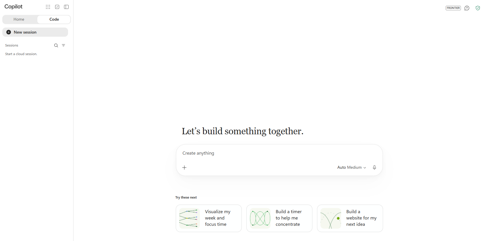

# Before you start

[Overview](index.md) | [Exercise 1: No-code](01-no-code.md) | [Exercise 2: Pro-code](02-pro-code.md)

Complete this page before the lab starts. Part 1 is for everyone. Part 2 is only needed for Exercise 2 (pro-code).

**Time:** about 30 minutes, plus waiting time for Microsoft 365 to index your training content (see [Step 6](#step-6-check-that-copilot-can-find-your-training-content)). Do Part 1 at least a few hours before the lab, ideally the day before.

## What you need

| You need | Why | Who provides it |
| --- | --- | --- |
| A **training account** in a non-production Microsoft 365 tenant, with an Exchange Online mailbox, OneDrive and Teams | The app reads your own calendar, mail, chats and files | Your facilitator |
| Access to the **Code** tab in the Copilot app | You build the no-code app there | Your facilitator enables it for the tenant |
| Permission to **run** Copilot managed apps: a Power Apps Premium license, or a Copilot Credits spending policy that includes you | Every app launch and connector call is metered | Your facilitator |
| The **Office 365 Outlook** and **Work IQ** connectors allowed in your environment | The app uses them to read your calendar and find related content | Your facilitator |
| For Exercise 2 only: a Windows PC where you can install software, and a **GitHub Copilot** subscription | A coding agent (VS Code, the GitHub Copilot app or GitHub Copilot CLI) does the work on your machine | You or your organization |
| For Exercise 2 only: permission to create an **app registration** in Microsoft Entra ID | The starting version of the app signs in with its own registration | Your facilitator |

> [!IMPORTANT]
> Always use your **training** account and tenant. Do not use your production account, real customer data, or someone else's app IDs.

---

## Part 1: Everyone

### Step 1: Open a clean browser window

You will sign in with a training account. A separate browser window avoids mixing it up with your normal work account.

1. Open **Microsoft Edge**.
2. Press **Ctrl+Shift+N** to open an **InPrivate** window. (If you prefer, create a separate Edge profile for the training account instead.)
3. Use this window for every browser step in the lab.

### Step 2: Sign in to Copilot and check the Code tab

1. In the InPrivate window, go to **https://copilot.cloud.microsoft**.
2. Sign in with the training account your facilitator gave you. If you are asked to set up a password or multifactor authentication, follow the prompts.
3. At the top of the left pane, check that you see two tabs: **Home** and **Code**.
4. Select **Code**. You should see the heading **Let's build something together.** and a box that says **Create anything**.



If you do not see the **Code** tab, tell your facilitator now. Code is enabled per tenant, so you cannot fix this yourself.

### Step 3: Create calendar events in Outlook

The app shows one day of your calendar. You will create three events on **the day you will do the lab**, so the app has something to show. The two meetings overlap on purpose, so you can see how the app places them side by side.

You can let Cowork create the events for you (Option A, faster) or create them by hand (Option B).

#### Option A: Ask Cowork to create the events

1. In the same InPrivate window, go to **https://copilot.cloud.microsoft** and open **Cowork** from the left pane.
2. Copy the prompt below into the message box. Replace `<LAB DAY>` with the date of your lab day, for example `12 November 2026`, then send it.

   ```text
   Create these three events in my Outlook calendar on <LAB DAY>, in my time zone.
   Do not invite anyone else.

   1. Title: "Orion launch – go/no-go review"
      Time: 10:00 to 11:00
      Make it a Teams meeting.
      Description (keep the line breaks):
      Agenda
      1. Confirm the Orion launch date (currently 14 March)
      2. Review the open risk on localisation for the German market
      3. Decide the launch budget split between digital and events
      4. Agree owners for the launch checklist

   2. Title: "Orion pricing sync"
      Time: 10:30 to 11:15
      Description: Quick sync on the Orion launch pricing tiers before the go/no-go review.

   3. Title: "Orion launch week"
      All-day event.

   Show me the three events before you create them.
   ```

3. Cowork lists the three events. Check the titles, date and times. If something is wrong, tell Cowork what to change in plain words, for example `Move the pricing sync to 10:30`.
4. When the list is correct, approve it. If Cowork shows a confirmation button, select it.
5. Go to **https://outlook.cloud.microsoft/calendar** and open your lab day. Check that you see one all-day event and two overlapping meetings. If an event is missing or wrong, fix it by hand with Option B.

#### Option B: Create the events by hand

1. In the same InPrivate window, go to **https://outlook.cloud.microsoft/calendar**.
2. Select **New event** (top left).
3. Create the **first meeting** with these values:

   - **Title:** `Orion launch – go/no-go review`
   - **Attendees:** One or two colleagues from your training tenant. If you have none, leave it empty.
   - **Date and time:** Your lab day, **10:00 to 11:00**
   - **Location:** `Teams meeting` (turn on the **Teams meeting** toggle)

4. Click in the large description box and paste this agenda:

   ```text
   Agenda
   1. Confirm the Orion launch date (currently 14 March)
   2. Review the open risk on localisation for the German market
   3. Decide the launch budget split between digital and events
   4. Agree owners for the launch checklist
   ```

5. Select **Save** (or **Send**, if you added attendees).
6. Select **New event** again and create the **second meeting**:

   - **Title:** `Orion pricing sync`
   - **Date and time:** Your lab day, **10:30 to 11:15** (it overlaps the first meeting)
   - **Description:** `Quick sync on the Orion launch pricing tiers before the go/no-go review.`

7. Select **Save**.
8. Select **New event** again and create an **all-day event**:

   - **Title:** `Orion launch week`
   - **Date:** Your lab day
   - **All day:** Turn on the **All day** toggle

9. Select **Save**. Your calendar for the lab day now shows one all-day event and two overlapping meetings.

### Step 4: Send yourself two emails in Outlook

The briefing looks for emails related to the meeting. You will send two emails to yourself: one with a decision and one with an open question.

#### Option A: Ask Cowork to send the emails

1. In **Cowork**, send this prompt:

   ```text
   Send two emails to me only (my own address, nobody else).

   Email 1
   Subject: Orion launch – decision on launch date
   Body:
   Hi team,

   Following yesterday's call, we agreed to move the Orion launch date to 14 March.
   Marketing will update the campaign calendar by Friday.
   Owner for the launch checklist: Product Marketing.

   Thanks

   Email 2
   Subject: Orion launch – open question on German localisation
   Body:
   Hi,

   We still have an open question for the Orion launch: the German localisation
   of the product pages is not finished. Can we launch in Germany on 14 March,
   or should we delay that market by two weeks?

   Please bring a recommendation to the go/no-go review.

   Show me both drafts before you send them.
   ```

2. Check that each draft is addressed **only to you**, then approve sending.
3. Go to **https://outlook.cloud.microsoft/mail** and check that both emails are in your **Inbox**. If one is missing, send it by hand with Option B.

#### Option B: Send the emails by hand

1. Go to **https://outlook.cloud.microsoft/mail**.
2. Select **New mail**.
3. In **To**, type your own training email address.
4. Use this subject and body, then select **Send**:

   **Subject:**

   ```text
   Orion launch – decision on launch date
   ```

   **Body:**

   ```text
   Hi team,

   Following yesterday's call, we agreed to move the Orion launch date to 14 March.
   Marketing will update the campaign calendar by Friday.
   Owner for the launch checklist: Product Marketing.

   Thanks
   ```

5. Select **New mail** again, address it to yourself, and send this second email:

   **Subject:**

   ```text
   Orion launch – open question on German localisation
   ```

   **Body:**

   ```text
   Hi,

   We still have an open question for the Orion launch: the German localisation
   of the product pages is not finished. Can we launch in Germany on 14 March,
   or should we delay that market by two weeks?

   Please bring a recommendation to the go/no-go review.
   ```

6. Open your **Inbox** and check that both emails arrived.

### Step 5: Create a document and a Teams message

**Create a Word document in OneDrive:**

1. Go to **https://www.office.com** and select **Word** in the left app bar (or go to **https://word.cloud.microsoft**).
2. Select **Blank document**.
3. Select the file name at the top (it says *Document* or *Document1*) and rename it to `Orion launch plan`. Press **Enter**. The file is saved to your OneDrive.
4. Paste this text into the document:

   ```text
   Orion launch plan

   Launch date: 14 March
   Markets: United Kingdom, France, Germany (German localisation still open)
   Budget: 60% digital campaigns, 40% events, to be confirmed at the go/no-go review
   Risks:
   - German product pages are not localised yet
   - Event venue in Paris is not yet confirmed
   Next steps:
   - Product Marketing owns the launch checklist
   - Finance to confirm the budget split
   ```

5. Wait until the top bar shows **Saved**, then close the tab.

**Post a message in Microsoft Teams:**

1. Go to **https://teams.cloud.microsoft** and sign in with the training account.
2. Select **Chat** in the left bar.
3. Open a chat with a colleague from the training tenant. If you have none, open the chat with **yourself** (your own name appears at the top of the chat list).
4. Send this message:

   ```text
   Quick update on Orion launch: Finance has not confirmed the 60/40 budget split yet. Let's close it at the go/no-go review.
   ```

### Step 6: Check that Copilot can find your training content

New emails, documents and chats can take **from a few minutes to several hours** before Copilot can search them. The briefing in the app uses the same search, so check it here first.

1. Go back to **https://copilot.cloud.microsoft** and select the **Home** tab.
2. Paste this prompt into the chat box and press **Enter**:

   ```text
   What do you know about the Orion launch? Look in my emails, Teams chats, meetings and files. List each source you used.
   ```

3. Check the answer:
   - **Good:** the answer mentions the 14 March date, the German localisation question, or the 60/40 budget, and lists your emails, document or chat as sources.
   - **Not yet:** Copilot says it cannot find anything. Wait an hour and try again. Nothing is broken; the content is not indexed yet.

> [!NOTE]
> If you do the lab on a different day from the one you chose in Step 3, open each calendar event in Outlook and change its date to the new lab day.

**Checkpoint:** You can open the Code tab, your lab day has three Orion events, and Copilot can find at least one of your Orion emails, documents or chats.

---

## Part 2: Exercise 2 only (pro-code)

Skip this part if you only do Exercise 1.

### Step 7: Get the lab files

1. Get a copy of this lab on your PC. If your facilitator shared a Git repository, clone it. If they shared a ZIP file, right-click it, select **Extract All**, and extract it to `C:\labs`.
2. Check that you have a folder like `C:\labs\copilot-managed-runtime-labs` that contains a `scripts` folder and a `samples` folder.

### Step 8: Install the tools with the setup script

The lab includes a script that installs everything Exercise 2 needs:

| Tool | Used for |
| --- | --- |
| Node.js LTS 24.11 or later (includes npm) | Building and running the web app |
| Git 2.27 or later, with Git Credential Manager | Saving and publishing your code |
| Visual Studio Code | Editing the code, and a coding agent with GitHub Copilot Chat |
| GitHub Copilot CLI | A coding agent in the terminal. It also installs the plugin used by the GitHub Copilot app |
| Copilot Managed Runtime CLI (`ms`) | Creating, previewing and deploying the managed app |

The script uses the package sources already configured on your PC (for example, your company's internal npm registry). It never changes them.

1. Select **Start**, type `PowerShell`, and open **Windows PowerShell** (no need to run it as administrator).
2. Go to the lab folder. Change the path if you extracted it somewhere else:

   ```powershell
   cd C:\labs\copilot-managed-runtime-labs
   ```

3. Allow the script to run in this window only:

   ```powershell
   Set-ExecutionPolicy -Scope Process -ExecutionPolicy Bypass
   ```

   If your company blocks this command, ask your IT team to install the tools in the table above instead.

4. Run the setup script:

   ```powershell
   .\scripts\Install-Prerequisites.ps1
   ```

5. While it runs, Windows may ask you to accept a license agreement or allow an installer to make changes. Accept these prompts. The script prints `[OK]` for each tool that is ready.
6. When it finishes, **close the PowerShell window** and open a new one. New tools are only visible in new windows.
7. In the new window, check that everything is installed:

   ```powershell
   cd C:\labs\copilot-managed-runtime-labs
   Set-ExecutionPolicy -Scope Process -ExecutionPolicy Bypass
   .\scripts\Install-Prerequisites.ps1 -CheckOnly
   ```

8. The last lines should say **All tools are ready.** If a tool shows `[FAILED]`, run step 4 again. If it still fails, copy the error message and share it with your facilitator.

### Step 9: Choose your coding agent and add the managed apps plugin

In Exercise 2 a **coding agent** does the work for you: you describe what you want, and the agent edits the code and runs the commands. Pick the one you're most comfortable with. The prompts in the lab work the same in all of them.

| Coding agent | Good for |
| --- | --- |
| **Visual Studio Code** with GitHub Copilot Chat in **Agent** mode | People who like to see the code and the chat side by side |
| **GitHub Copilot app** | People who prefer a desktop chat app |
| **GitHub Copilot CLI** | People who are comfortable in a terminal |

Whichever you choose, you add the **Copilot Managed Runtime plugin**. It teaches the agent how to build, preview and deploy Copilot managed apps, with skills such as **dev**, **play**, **deploy** and **share**.

#### Option A: Visual Studio Code

1. Open **Visual Studio Code** and sign in to GitHub Copilot: select the **Accounts** icon (bottom left) and **Sign in with GitHub to use GitHub Copilot**.
2. Open the Chat view with **Ctrl+Alt+I**. In the mode picker at the bottom of the chat box, select **Agent**.
3. Press **Ctrl+Shift+P** to open the Command Palette, type `Chat: Install Plugin from Source` and press **Enter**.
4. Enter `https://github.com/microsoft/Managed-Apps` and press **Enter**. Confirm when VS Code asks whether you trust the plugin.

   If you don't find the command, your organization may have turned off agent plugins. Ask your facilitator, or use Option C.

5. To check, select the **gear** icon at the top of the Chat view, then **Agent Customizations** (or **Plugins**). **microsoft-managed-apps** is listed.

#### Option B: GitHub Copilot app

The GitHub Copilot app uses the same plugins as GitHub Copilot CLI. Install the plugin once with the steps in Option C, then open the GitHub Copilot app and sign in with your GitHub account. The plugin's skills are available in every new session.

#### Option C: GitHub Copilot CLI

1. In PowerShell, start GitHub Copilot CLI:

   ```powershell
   copilot
   ```

2. If it asks whether you trust the current folder, select **Yes**.
3. If you are not signed in yet, type `/login`, press **Enter**, and follow the instructions to sign in with your GitHub account in the browser.
4. Add the plugin marketplace. Type this and press **Enter**:

   ```text
   /plugin marketplace add microsoft/Managed-Apps
   ```

5. Install the plugin:

   ```text
   /plugin install microsoft-managed-apps@Managed-Apps
   ```

6. Type `/exit` and press **Enter**. The plugin loads the next time you start GitHub Copilot CLI.
### Step 10: Sign in to the managed apps CLI

1. In PowerShell, run:

   ```powershell
   ms auth login
   ```

2. A browser window opens. Pick your **training** account (not your work account).
3. Back in PowerShell, check which account is signed in:

   ```powershell
   ms auth status
   ```

4. Make sure the output shows your training account and tenant. If it shows the wrong account, run `ms auth logout` and repeat step 1.

> [!NOTE]
> The CLI and the browser sign in separately. Signing in with `ms auth login` does not change the account in your browser, and the other way round.

**Checkpoint:** `Install-Prerequisites.ps1 -CheckOnly` says **All tools are ready**, your coding agent has the managed apps plugin, and `ms auth status` shows your training account.

You create the Microsoft Entra app registration for the starting app at the beginning of [Exercise 2](02-pro-code.md).

## References

- [Admin overview and creation-path defaults](https://learn.microsoft.com/microsoft-365/admin/manage/apps/)
- [Governance settings and required roles](https://learn.microsoft.com/microsoft-365/admin/manage/apps/governance)
- [Licensing FAQ](https://learn.microsoft.com/microsoft-365/admin/manage/apps/licensing-faq)
- [SDK prerequisites](https://learn.microsoft.com/microsoft-365/copilot-managed-runtime/developer/apps/)
- [GitHub Copilot quickstart](https://learn.microsoft.com/microsoft-365/copilot-managed-runtime/developer/apps/quickstart-github-copilot)
