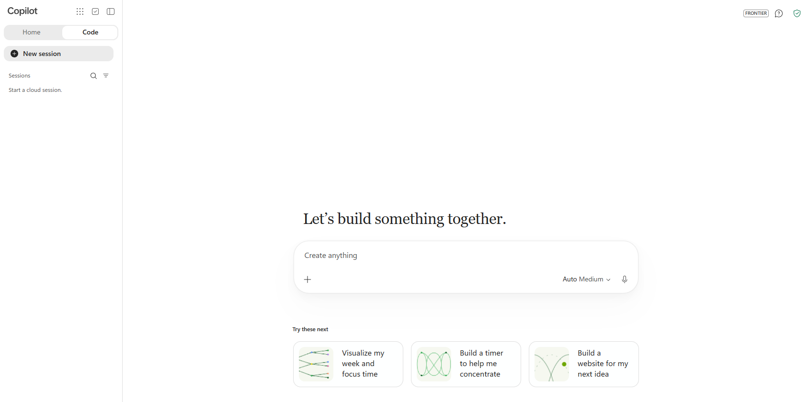
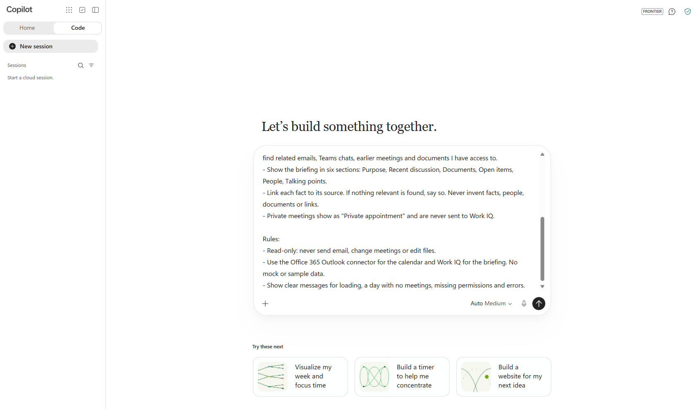
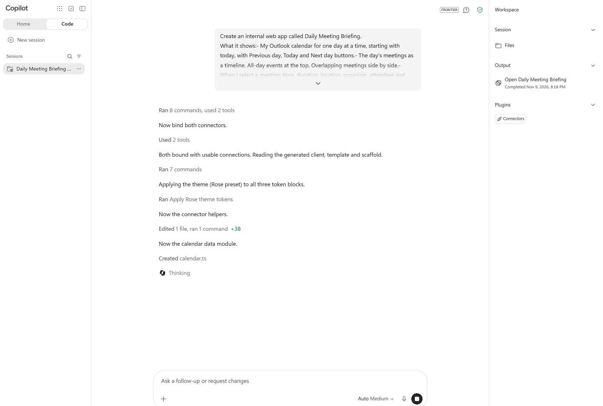
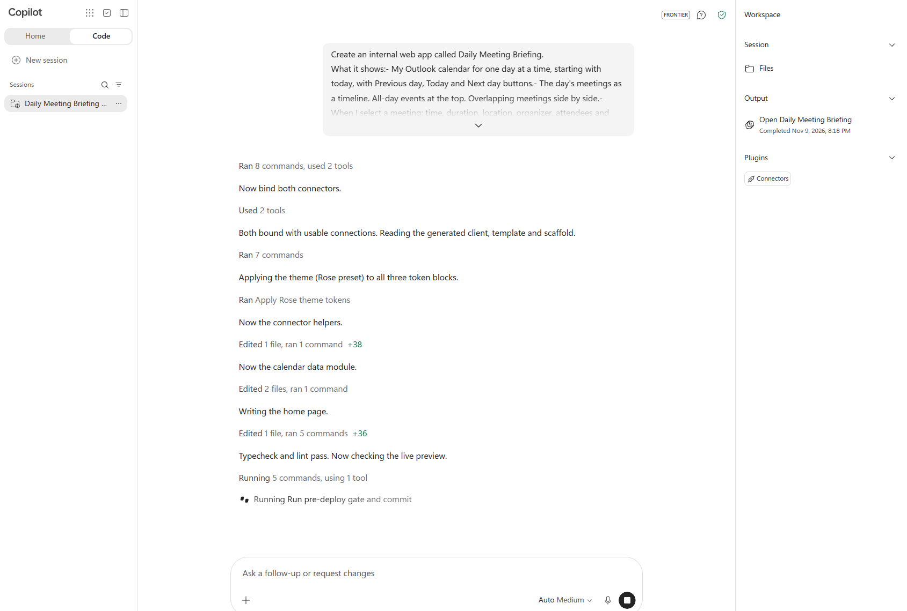
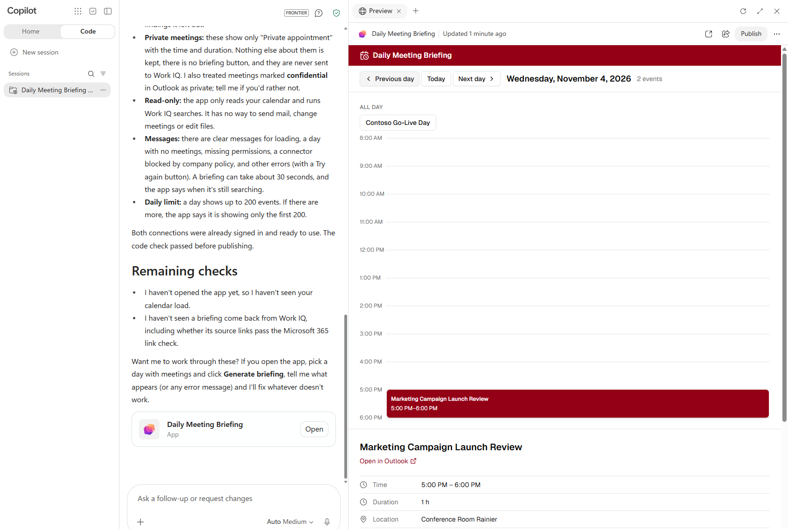
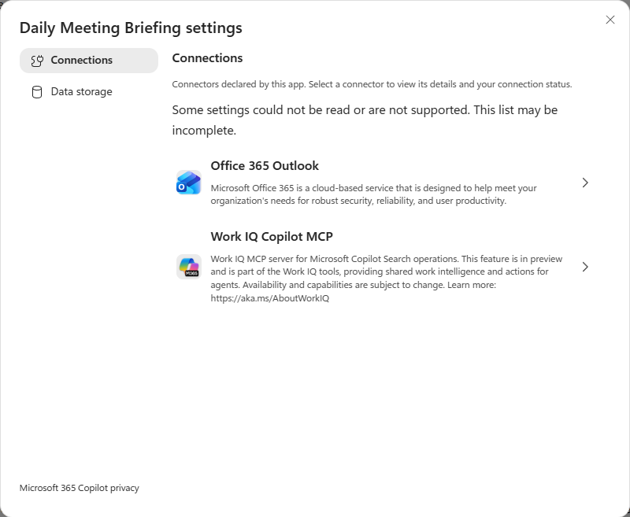
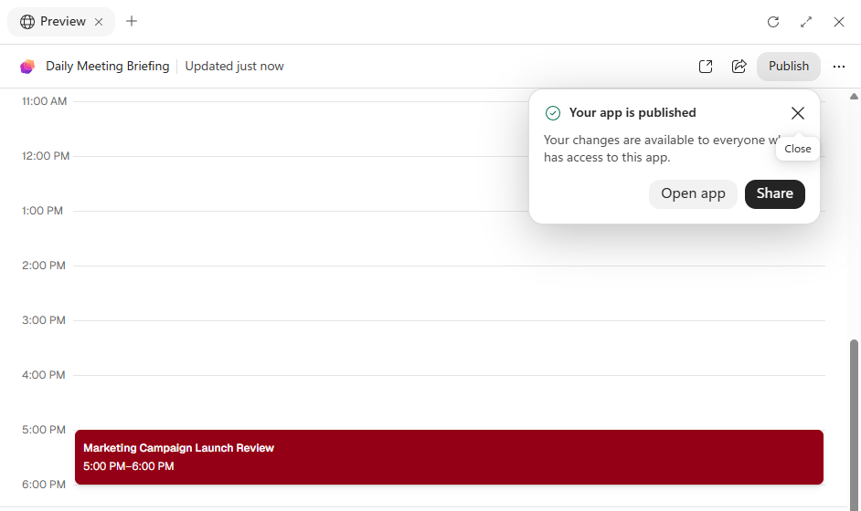
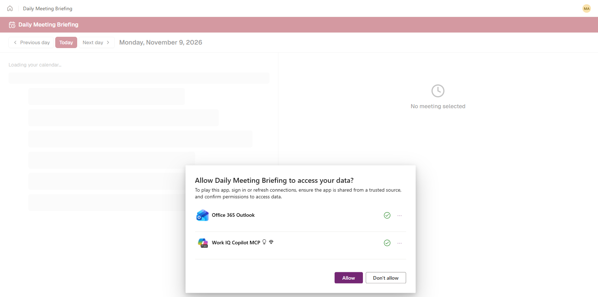

# Exercise 1: Build Daily Meeting Briefing with Code (no code)

[Overview](index.md) | [Prerequisites](00-prerequisites.md) | [Next: Pro-code](02-pro-code.md)

**Tool:** the **Code** tab of the Microsoft 365 Copilot app, in your browser. **Time:** 75–90 minutes. **Level:** Beginner.

> **Videos for this exercise** (narrated, voice only):
>
> - [Build and publish the app](videos/no-code-walkthrough.mp4) (90 seconds): steps 1-6, from the prompt to the published app. Watch it before you start.
> - [Set up a billing policy](videos/billing-policy-setup.mp4) (2 minutes): step 7a.
> - [App controls for connectors and policies](videos/admin-controls.mp4) (3 minutes): steps 7b and 7c.

## What you will build

**Daily Meeting Briefing** is a small web app that:

- Shows your Outlook calendar one day at a time.
- Shows the details of the meeting you select.
- When you select **Generate briefing**, it uses Work IQ to find related emails, Teams chats, earlier meetings and documents, and turns them into a short briefing.

You build it by describing it in plain English. Code writes the app, connects it to your Microsoft 365 data through **connectors**, and runs it on **Copilot Managed Runtime**, Microsoft's hosting for these apps. You don't install anything, write code or create Azure resources.

**Words used in this exercise:**

| Word | What it means |
| --- | --- |
| **Connector** | A ready-made, governed link to a service, such as Office 365 Outlook. The app asks the connector for data instead of calling the service directly. |
| **Work IQ** | The Microsoft 365 service that finds work context (emails, chats, meetings and files) that you have access to. |
| **Preview** | The version of the app you test inside Code while you build it. Only you can use it. |
| **Publish** | Makes the current version available as a real app with its own web address. |
| **Share** | Gives other people permission to open the published app. |

**Before you start:** complete [Part 1 of the prerequisites](00-prerequisites.md#part-1-everyone). You need the three Orion calendar events, the two emails, the document and the Teams message.

## Step 1: Open the Code tab

1. Open a Microsoft Edge InPrivate window (**Ctrl+Shift+N**).
2. Go to `https://copilot.cloud.microsoft` and sign in with your **training account**.
3. At the top of the left pane, select **Code**.
4. If you see an earlier session, select **New session** in the left pane.

You should see the heading **Let's build something together.** and a box that says **Create anything**.



*The Code tab before anything has been created (captured November 9, 2026). Labels can change while the product is in preview.*

The **Auto Medium** label in the box is the model picker. Leave it as it is.

## Step 2: Describe the app

1. Select the **Create anything** box.
2. Copy the prompt below and paste it into the box (**Ctrl+V**). The text keeps its line breaks.

   ```text
   Create an internal web app called Daily Meeting Briefing.
   What it shows:
   - My Outlook calendar for one day at a time, starting with today, with Previous day, Today and Next day buttons.
   - The day's meetings as a timeline. All-day events at the top. Overlapping meetings side by side.
   - When I select a meeting: time, duration, location, organizer, attendees and agenda.
   Briefing:
   - Add a Generate briefing button for the selected meeting. Only when I click it, use Work IQ to find related emails, Teams chats, earlier meetings and documents I have access to.
   - Show the briefing in six sections: Purpose, Recent discussion, Documents, Open items, People, Talking points.
   - Link each fact to its source. If nothing relevant is found, say so. Never invent facts, people, documents or links.
   - Private meetings show as "Private appointment" and are never sent to Work IQ.
   Rules:
   - Read-only: never send email, change meetings or edit files.
   - Use the Office 365 Outlook connector for the calendar and Work IQ for the briefing. No mock or sample data.
   - Show clear messages for loading, a day with no meetings, missing permissions and errors.
   ```

3. Check that the whole prompt is in the box. You can scroll inside the box to see the beginning.

   

4. Select the **send** button (the round button with an up arrow) at the bottom right of the box.

**Why the prompt is written this way:** each line describes something you can check later. The **Rules** section tells Code which connectors to use and what the app must never do. Being specific here saves you from fixing things afterwards.

## Step 3: Watch Code build the app

Code now works on its own. It usually takes **10–20 minutes**. You don't need to do anything, but keep the tab open.

While it works:

- The prompt you sent appears at the top of the page.
- Short progress messages appear under it. Grey lines such as **Ran 8 commands, used 2 tools** are steps Code completed. Select one to see the details.
- A **Stop** button (a black square) replaces the send button. **Don't select it** unless you want to cancel the build.
- The **Workspace** pane on the right has three groups: **Session > Files** (the app's source files), **Output** (the app) and **Plugins > Connectors**.



These are the messages to look out for:

| Message | What it means |
| --- | --- |
| **Now bind both connectors** | Code is adding the Office 365 Outlook and Work IQ connectors to the app. |
| **Both bound with usable connections** | Both connectors are signed in with your account and ready to use. |
| **Applying the theme** | Code picked colours and styles. Yours may differ from the screenshots. |
| **Typecheck and lint pass** | Code checked its own code for mistakes. |
| **Run pre-deploy gate and commit** | Code is doing final checks and saving the version you will preview. |



**If Code asks you a question** (for example, to sign in to a connector or allow access), read it and answer it. Use your training account. If a sign-in window opens, complete it and go back to the Code tab.

**If you see an error**, type this into the **Ask a follow-up or request changes** box at the bottom and send it:

```text
The last step failed. Explain what went wrong in one sentence and fix it.
```

When Code finishes, the Stop button turns back into the send button. The chat shows:

- A summary of what Code built.
- A **Remaining checks** list. These are things Code couldn't test itself, such as whether a briefing returns real data. You test them in Step 4.
- A **Daily Meeting Briefing** card with an **Open** button.

A **Preview** panel also opens on the right side of the page.

## Step 4: Test the app in the preview

The preview runs the app with **your** data. It can take a minute to load (you'll see **Loading app preview…**).



*Your app should look similar. The colours, layout and meetings will be different.*

The top of the Preview panel shows the app name and **Updated just now**, then three buttons: **open in a new tab** (a square with an arrow), **Share** and **Publish**. The **⋯** button opens more options.

Test each item and tick it off:

1. **Calendar for the lab day.** Select **Next day** or **Previous day** until you reach the day you used in [Prerequisites Step 3](00-prerequisites.md#step-3-create-calendar-events-in-outlook).
   - [ ] **Orion launch week** appears at the top as an all-day event.
   - [ ] **Orion launch – go/no-go review** (10:00–11:00) and **Orion pricing sync** (10:30–11:15) appear **side by side**, because they overlap.
2. **Meeting details.** Select **Orion launch – go/no-go review**.
   - [ ] The time, duration, location, organizer and the agenda you pasted are shown.
3. **Briefing.** With the go/no-go review still selected, select **Generate briefing** once. It can take about 30 seconds.
   - [ ] The briefing has the six sections from your prompt.
   - [ ] It mentions things from your training content, such as the **14 March** launch date or the **German localisation** question.
   - [ ] Select one source link. It opens the email, chat or document that supports the fact.
4. **Empty day.** Move to a day with no meetings.
   - [ ] The app says there are no meetings, rather than showing an error or invented data.

**If the briefing says nothing relevant was found**, that's the correct behaviour when Work IQ finds nothing. It usually means your training content isn't indexed yet. Run the check in [Prerequisites Step 6](00-prerequisites.md#step-6-check-that-copilot-can-find-your-training-content) again, wait, and try **Regenerate briefing** later. Don't ask Code to "make it work". It might add fake data.

**If something doesn't look right**, describe the problem in the **Ask a follow-up or request changes** box, for example:

```text
The two overlapping Orion meetings are shown on top of each other. Show overlapping meetings side by side in the timeline.
```

### Look at the app's connections

1. At the top right of the Preview panel, select **⋯**, then **Daily Meeting Briefing settings**.
2. Select **Connections**. You see the two connectors that the app uses: **Office 365 Outlook** and **Work IQ Copilot MCP**.

   

3. Select a connector to see its details and your connection status. You may see **Some settings could not be read or are not supported**. This is expected in the preview.
4. Close the dialog with the **X**.

**Behind the scenes:** the app never sees your password or a Microsoft Graph token. It asks the connector for data, the connector calls Microsoft 365 with **your** permissions, and the administrator's policies decide which connectors and actions are allowed. You'll look at those policies in Step 7.

## Step 5: Ask for an improvement

Apps built with Code are changed the same way they are created: by asking.

1. Select the **Ask a follow-up or request changes** box at the bottom of the chat.
2. Paste this prompt and select **send**:

   ```text
   Keep the existing connectors and the read-only rules. Make these changes:
   - Show the time zone next to the date at the top.
   - Add a Refresh button that reloads the calendar for the selected day.
   - If the briefing fails, show a Try again button. Don't retry automatically.
   ```

3. Wait for Code to finish (usually a few minutes). The preview reloads and shows **Updated just now**.
4. Check that the time zone and the **Refresh** button are visible, and select **Refresh** once.

## Step 6: Publish and share the app

Until now, only you can use the app inside Code. Publishing gives it its own web address on Copilot Managed Runtime.

### Publish

1. At the top right of the Preview panel, select **Publish**.
2. The button shows **Publishing…** for a few seconds. There's no confirmation dialog.
3. A message appears: **Your app is published. Your changes are available to everyone who has access to this app.**

   

4. Select **Open app**. The app opens in a new browser tab.

Each time you change the app later, select **Publish** again. Until you do, people using the published app keep seeing the previous version.

### Open the published app

1. In the new tab, if you're asked to pick an account, select your training account.
2. You see **Fetching your app…**, then the app.
3. The first time you open the published app, it asks: **Allow Daily Meeting Briefing to access your data?** It lists the two connectors. A green tick means you already have a working connection for that connector.

   

4. Read the list, then select **Allow**.
5. Go to your lab day and generate one briefing, as in Step 4.
6. Look at the address bar. The published app runs at an address that starts with `https://play.preview.managedapps.cloud.microsoft/apps/`. Copy this address. It's the **published app URL**.

**Why the dialog appears:** the preview inside Code uses the maker's connections. The published app asks **each user** to allow it to use their own connections. Every user sees only their own calendar and the content they already have access to.

### Share with one colleague

Do this only if your facilitator has paired you with a colleague in the same tenant.

1. Go back to the Code tab.
2. At the top of the Preview panel, select **Share** (the icon to the left of **Publish**).
3. Enter your colleague's name and select them from the list.
4. Give them permission to **use** the app only. Don't give edit permission and don't share with the whole organization.
5. Confirm the share, then send your colleague the published app URL in a Teams chat.
6. Ask your colleague to open the URL and select **Allow**.
   - [ ] They see **their own** calendar, not yours.

**Behind the scenes:** sharing gives your colleague permission to open the app. It doesn't give them access to your mailbox, chats or files. If your colleague can't open the app, the cause is usually the sharing permission, their license (see Step 7) or a policy, not their data access.

**Checkpoint:** your app is published, you can open it from its own URL, and you've generated at least one briefing there.

## Step 7: Practice the administrator controls

Copilot Managed Runtime apps are controlled from the **Microsoft 365 admin center**. In this step you look at three areas: **billing**, **connectors and actions**, and **sharing and app inventory**.

> **Important:** You need an administrator role. If your training account isn't an administrator, pair with your facilitator and follow along. Change settings **only in a training tenant**, and write down every original value so you can put it back at the end.

### 7a. Billing: who pays to run the app

Running a Copilot Managed Runtime app costs **0.1 Copilot Credits per API call**. A call happens each time the app opens or reads data through a connector, so one click can make several calls. Work IQ is billed separately. Users are covered either by a **Power Apps Premium** license or by a **spending policy** that lets them use Copilot Credits.

You create a spending policy that covers the whole tenant.

> **Watch first:** the [2-minute narrated video](videos/billing-policy-setup.mp4) walks through every screen of the wizard below.

**Roles:** you need **Global administrator** or **Billing administrator** to create a spending policy.

#### Check that usage-based billing is set up

1. Go to `https://admin.microsoft.com` and sign in with an administrator account.
2. In the left menu, select **Copilot** > **Cost management**. If you don't see **Copilot**, select **Show all** first.
3. If you see a **Get started** button, usage-based billing isn't set up in this tenant yet, and it needs a billing method. Ask your facilitator to set it up ([setup steps](https://learn.microsoft.com/copilot/implement/usage-based-billing-copilot-credits-setup)), then continue.

#### Create the spending policy

1. Select the **Configuration** tab, then **+ Add spending policy**. A wizard with six steps opens.
2. **Policy scope:**
   1. In **Give this spending policy a name**, type `Managed apps lab`.
   2. Under **Policy scope**, keep **Identity** and **All users**. The policy covers everyone in the tenant.
   3. Select **Next**.
3. **Agents and services:** make sure **Copilot Managed Runtime** is checked. It's the service that runs your apps. Leave the other items as they are and select **Next**.
4. **Limits and alerts:**
   1. Under **Set the monthly spending limit for this policy**, select **Limit monthly spending**. Enter at least the minimum shown under the box. The minimum depends on how many users the policy covers (for example, 50,000 credits, about $500 a month).
   2. Under **Select monthly budget limits for users**, select **Limit monthly spending per user**. Enter at least the minimum shown under the box (for example, 2,000 credits, about $20 a month).
   3. Leave **Define alerts** off and select **Next**. If **Next** is greyed out, one of the values is below the minimum; the box with the red outline tells you which.
5. **Model template:** keep **Apply model selection automatically** and select **Next**.
6. **Billing method:** keep the default billing method (your Azure subscription) and select **Next**. If the tenant has prepaid credits, they are used first.
7. **Review and add policy:** check the summary, then select **Create spending policy**.

You return to the **Configuration** tab, where a green banner confirms the policy was added. **Managed apps lab** appears in the list as **Enabled** and applies right away. Usage reports can take up to 24 hours to show data.

> **Note:** If a user is covered by more than one spending policy, the one with the **highest** limit applies. If your tenant already has a policy with no limit for all users, that policy wins over this one.

> **Tip:** To cover only yourself instead of the whole tenant, in step 2 switch from **All users** to **Specific groups** and pick a group that contains only your training account.

### 7b. Connectors and action-level security

The administrator controls which connectors apps can use, and also which **actions** each connector can perform. For example, an app can be allowed to read calendar events but not to send email.

> **Watch first:** the [3-minute narrated video](videos/admin-controls.mp4) tours every screen in 7b and 7c.

1. In the Microsoft 365 admin center ([admin.cloud.microsoft](https://admin.cloud.microsoft)), select **Apps** > **Settings** > **Environment groups**.
2. Select **Default Environment Group**. Its page shows four rules: **Routing**, **Connectors and MCP servers**, **Sharing** and **Content security policy**. The **Managed by** column shows who maintains each rule: **Microsoft**, or your organization once an admin has edited it.
3. Select **Connectors and MCP servers**. The **Control data sources for apps** panel opens. Its heading shows how many connectors are **Allowed** and how many are **Blocked**. The list shows the allowed ones, and the **Allowed actions** column shows either **All actions** or a number.
4. Type **Outlook** in the search box. Find **Office 365 Outlook** and note its **Allowed actions**.
5. Select the checkbox next to **Office 365 Outlook**, then select **Edit actions**. Every action has its own **On** checkbox. Scroll to actions such as **Get emails**, **Send an email** and **Delete email**.
6. Select **Cancel** to close the list without saving.
7. Select **Add connectors**. The **Connector catalog** opens, listing the connectors you can allow. Search for **Salesforce** to see how a new connector would be added, then select **Cancel**.

**Try it (training tenant only, with your facilitator's approval):**

1. In the **Control data sources for apps** panel, select the checkbox next to **Office 365 Outlook** > **Edit actions**.
2. Clear the **On** checkbox for the action that reads calendar events. Write down its exact name so you can turn it back on.
3. Select **Save**.
4. Open your published app and select **Refresh** (or **Today**).
5. Turn the action back **on** at the end of the lab and save.

> **Policy changes are not instant.** It can take **several minutes, and sometimes much longer**, before a change reaches running apps. You will probably **not** see the calendar blocked straight away. Carry on with 7c, then come back and select **Refresh** in the app again. If you still don't see the block before the end of the lab, that's expected; your facilitator will show what it looks like. When the change applies, the app should show a permission or policy message, not an empty calendar or sample data. Turning the action back on takes the same time to apply.

**Remember:** a connector in the allow list doesn't mean all of its actions are allowed. Always check the actions, especially the ones that send, change or delete data.

### 7c. Sharing, content security and app inventory

1. Go back to the environment group page from 7b.
2. Select **Sharing**. The banner says **Built-in protection for every app, Managed by Microsoft**. Shared links can be opened by **Anyone in the org** or **Only the users and groups selected when the app is shared**. A separate checkbox decides whether **guest users** can open apps from shared links. Select **Close**.
3. Select **Content security policy**. It limits which addresses an app can load content from or contact from the browser. Look at the list of directives, such as **Default-src** and **Connect-src**. This is why an app that calls an external web address directly can work on a developer's PC but be blocked once it's hosted. Select **Close** without changing anything.
4. Select **Apps** > **All apps** in the left menu. Find **Daily Meeting Briefing**. It can take some time to appear after you publish.
5. Open the app and select the **Connectors** tab. It lists the connectors the app uses, such as **Work IQ Copilot MCP** and **Office 365 Outlook**. Compare them with what you saw in 7b. Note the **Block** button at the top: an admin can block a single app without touching any rule. Don't select it.

> **Note:** **Sharing** and **Content security policy** are managed by Microsoft by default. To change them you select **Edit this rule**, and from then on Microsoft stops updating that rule automatically. The same happens to the connector list once you edit it: the **Managed by** column changes to your organization.

**Checkpoint:** you can explain who pays to run the app, the difference between allowing a connector and allowing its actions, why sharing an app doesn't share your data, and why a policy change doesn't apply instantly.

## Clean up

1. If you turned off a connector action in 7b, turn it back on and save. Remember that this can also take a while to apply.
2. If you shared the app, ask your facilitator whether to remove your colleague's access. In Code, select **Share** and remove them.
3. Keep the spending policy if you're doing Exercise 2 in the same tenant. Otherwise, on the **Copilot** > **Cost management** > **Configuration** tab, select **⋮** next to **Managed apps lab** > **Delete**.
4. Keep your published app URL. Your facilitator may ask you to show it.

**Next:** [Exercise 2: Pro-code](02-pro-code.md)

## References

- [Copilot Managed Runtime default governance settings](https://learn.microsoft.com/microsoft-365/admin/manage/apps/governance)
- [Share a Copilot Managed Runtime app](https://learn.microsoft.com/microsoft-365/copilot-managed-runtime/developer/apps/share-app)
- [Licensing FAQ for Copilot Managed Runtime apps](https://learn.microsoft.com/microsoft-365/admin/manage/apps/licensing-faq)
- [Manage spending policies for Copilot Credits](https://learn.microsoft.com/copilot/implement/usage-based-billing-manage-copilot-credits)
- [Set up usage-based billing for Copilot Credits](https://learn.microsoft.com/copilot/implement/usage-based-billing-copilot-credits-setup)
